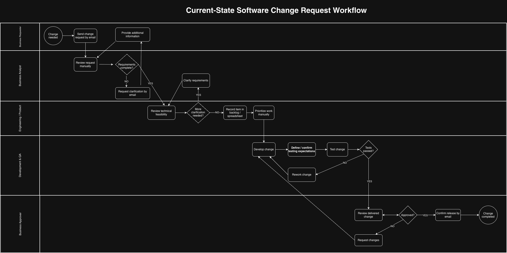
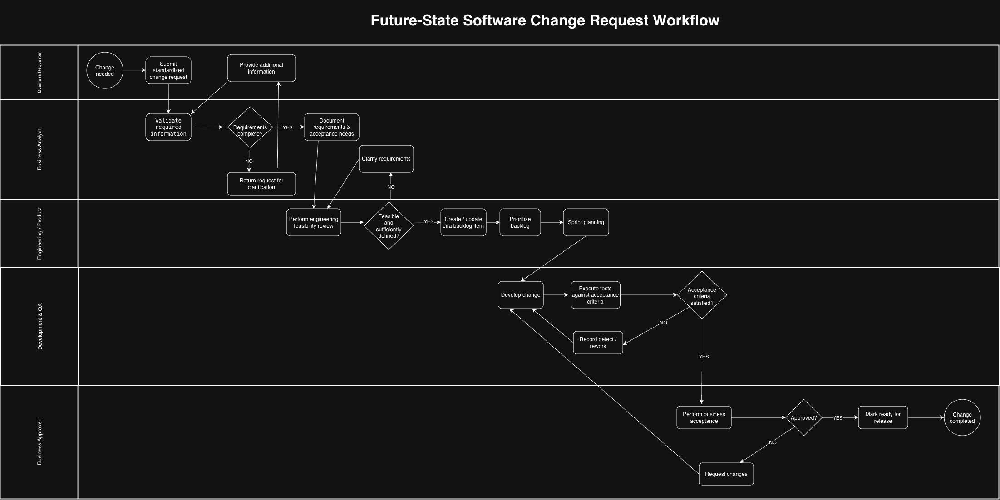

# Software Engineering & Business Process Analysis

### Business Requirements | BPMN | Agile/Scrum | Python | Process Improvement

[**View Interactive Workflow Demo**](https://ishgup22.github.io/Software-Engineering-Process-Analysis/)

A business analysis case study focused on improving how software change requests move from initial requirements through development, testing, and release approval.

I analyzed a manual change-request workflow, identified gaps in requirements and handoffs, and designed a more structured process with clear ownership, traceable requirements, and defined release controls. I also built an interactive workflow prototype and used Python to check whether the documented test scenarios covered the business requirements.

## Project Highlights

| Area | Work Completed |
|---|---|
| Requirements | 12 business and 12 functional requirements |
| Agile Delivery | 11 user stories and 20 acceptance criteria |
| Testing | 9 test scenarios with traceability checks |
| Process Design | Current-state and future-state BPMN maps |
| Analysis | Lean Six Sigma, gap analysis, and RACI |
| Prototype | Interactive change-request workflow |
| Key Finding | 58.3% explicit requirement-to-test coverage |

**Key finding:** The Python traceability audit found that only 7 of 12 business requirements and 7 of 12 functional requirements were explicitly referenced in the documented test scenarios. This identified coverage gaps that would need to be addressed before the proposed workflow could be considered fully tested.

---

## The Business Problem

Software change requests can become difficult to manage when requirements are scattered across emails, ownership isn't clear, and testing expectations are defined late in the process.

The current-state model highlighted four main issues:

- **Requirements gaps:** Incomplete requests led to repeated clarification between business and technical teams
- **Limited visibility:** Manual tracking made it difficult to follow a request's status and ownership
- **Disconnected testing:** Requirements were not consistently linked to acceptance criteria and test scenarios
- **Unstructured approvals:** Release decisions relied on informal communication rather than defined readiness checks

The goal was to design a workflow that addressed these gaps without adding unnecessary steps.

## My Approach

### 1. Map the Current Process

I documented the existing workflow, from request submission through engineering review, development, QA, and release confirmation.

### 2. Design the Future-State Workflow

I redesigned the process around standardized request intake, earlier requirement validation, defined responsibilities, centralized backlog tracking, and formal testing and approval checkpoints.

The proposed changes are summarized below:

| Process Area | Current State | Proposed Future State |
|---|---|---|
| Request Intake | Email-based requests | Standardized intake and validation |
| Requirements | Repeated clarification | Defined requirements before development |
| Tracking | Manual spreadsheets | Jira-ready backlog with ownership |
| Testing | Expectations defined late | Acceptance criteria and test traceability |
| Approval | Informal confirmation | Documented business acceptance and release readiness |

[View detailed process comparison](analysis/current-vs-future-analysis.md)

### 3. Translate Business Needs Into Delivery Requirements

I documented 12 business requirements and 12 functional requirements, then translated the workflow into 11 Agile user stories and 20 acceptance criteria.

The artifacts cover request validation, status tracking, ownership, engineering feasibility, testing, and release approvals.

I also prepared a Jira-ready backlog with priorities, story points, requirement references, and an illustrative four-sprint delivery plan.

**Project artifacts:**
- [Business Requirements](requirements/business-requirements.md)
- [Functional Requirements](requirements/functional-requirements.md)
- [User Stories](agile/user-stories.md)
- [Acceptance Criteria](agile/acceptance-criteria.md)
- [Jira Backlog](agile/jira-backlog.csv)
- [Scrum Delivery Plan](agile/scrum-plan.md)

### 4. Validate Requirements Against Testing

To check whether the documented testing covered the requirements, I used Python to audit explicit requirement references in the test scenarios.

The analysis found:

| Coverage Measure | Result |
|---|---|
| Business requirements referenced | 7 of 12 |
| Functional requirements referenced | 7 of 12 |
| Explicit coverage | 58.3% |
| Documented test scenarios | 9 |

The result exposed a gap between the requirements defined and the tests documented.

This is an explicit-reference coverage measure, not a measure of test execution success or production software quality.

[View Test Scenarios](testing/test-scenarios.md)

### 5. Analyze Process Waste and Ownership

I applied foundational Lean Six Sigma concepts to examine waiting time, rework, unnecessary handoffs, and fragmented tracking.

The analysis identified opportunities to move validation earlier, reduce avoidable clarification loops, and establish clearer decision points.

A RACI-style responsibility matrix defines ownership across business requesters, analysts, product owners, engineering, QA, and approvers.

- [Lean Six Sigma Analysis](analysis/lean-six-sigma-analysis.md)
- [Roles & Responsibilities](analysis/roles-responsibilities.md)

---

## Interactive Workflow Prototype

[**Open the Interactive Demo**](https://ishgup22.github.io/Software-Engineering-Process-Analysis/)

I built an interactive prototype to demonstrate how a change request progresses through requirements review, engineering, QA testing, business acceptance, and release readiness.

The prototype complements the process maps and written requirements by making the proposed workflow easier to explore.

It is a demonstration of the designed process, not a deployed enterprise workflow system.

---

## Tools & Methods

**Business Analysis:** Business and Functional Requirements, Gap Analysis, Stakeholder Responsibilities, RACI, Requirements Traceability

**Process Improvement:** BPMN, Current-State/Future-State Mapping, Root Cause Analysis, Lean Six Sigma Concepts

**Agile Delivery:** Scrum, User Stories, Acceptance Criteria, Jira-Ready Backlog, Sprint Planning

**Technical:** Python, HTML, JavaScript, Requirements Coverage Analysis, Test Scenario Design

---

## Project Outcome

The project produced a structured future-state workflow supported by documented requirements, process maps, Agile delivery artifacts, and test scenarios.

The most important result was identifying that **58.3% of business and functional requirements had explicit references in the documented tests**. That finding provided a concrete starting point for improving test coverage and release readiness.

The proposed workflow also established clearer ownership and earlier validation checkpoints to address issues identified in the current-state analysis.

**Project scope:** This is a simulated business analysis case study. The future-state workflow represents a design recommendation, not a production implementation. No measured cycle-time reductions, operational savings, or production improvements are claimed.
